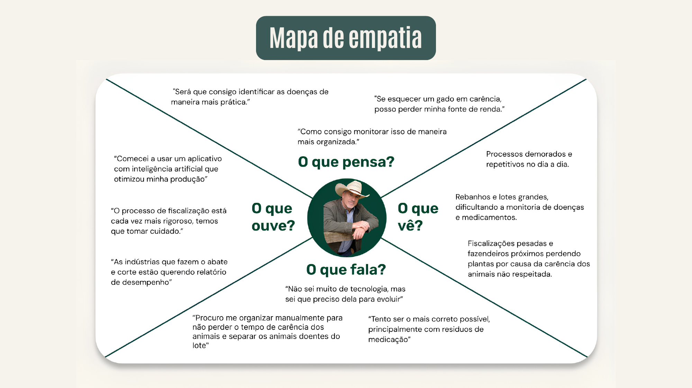

# Persona

## João Batista — pecuarista

46 anos, mora no interior do Mato Grosso.

**Dores**
- Dificuldade em gerir e acessar dados da aplicação de medicamentos.
- Consequências do baixo controle sanitário.
- Prejuízos financeiros por falhas no controle de carência dos remédios.

**Necessidades**
- Gestão eficiente dos intervalos medicamentosos e do bem-estar animal.
- Ferramenta digital simples e intuitiva.
- Alertas automáticos para prazos de medicação.

**Canais de comunicação**
- WhatsApp
- Redes sociais (principalmente Instagram e Facebook)

## Mapa de empatia

