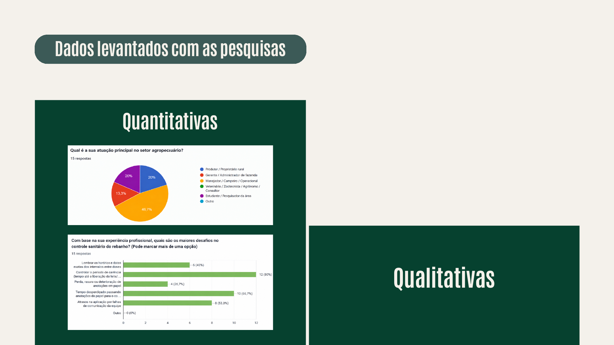
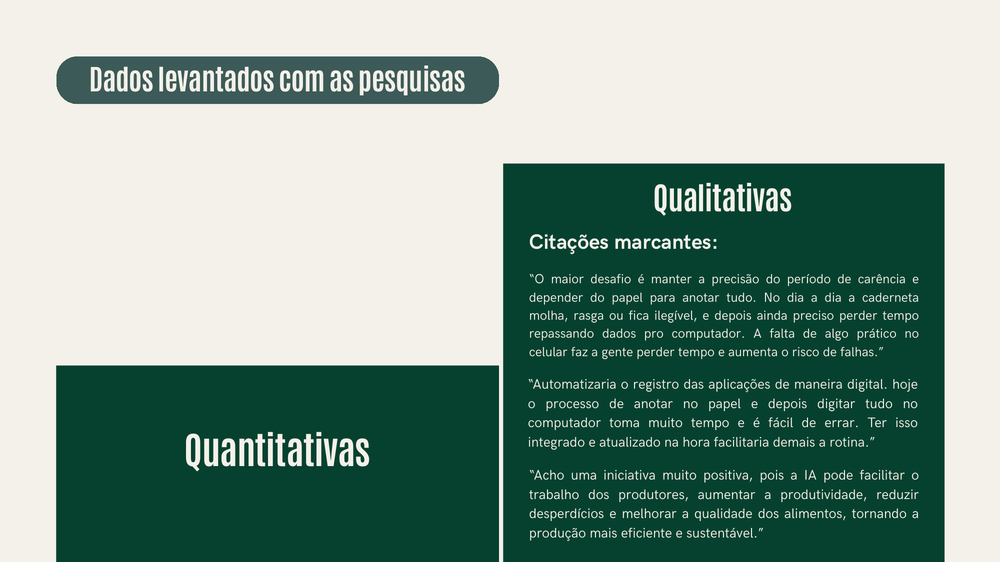

# Pesquisas qualitativas e quantitativas

Para embasar o projeto com dados do campo, a equipe aplicou um formulário em duas etapas:

1. **Produtores, veterinários e profissionais da pecuária bovina:** rotina, dores operacionais e desafios do manejo sanitário.
2. **Público em geral:** percepção sobre o uso de tecnologias digitais e inteligentes na gestão sanitária do setor.

- **Formulário:** [Google Forms](https://forms.gle/e5RELz7E8ZqGWZ9V7)

## Resultados

### Quantitativas

### Qualitativas

## Citações marcantes

> "O maior desafio é manter a precisão do período de carência e depender do papel para anotar tudo. No dia a dia a caderneta molha, rasga ou fica ilegível, e depois ainda preciso perder tempo repassando dados pro computador. A falta de algo prático no celular faz a gente perder tempo e aumenta o risco de falhas."

> "Automatizaria o registro das aplicações de maneira digital. Hoje o processo de anotar no papel e depois digitar tudo no computador toma muito tempo e é fácil de errar. Ter isso integrado e atualizado na hora facilitaria demais a rotina."

> "Acho uma iniciativa muito positiva, pois a IA pode facilitar o trabalho dos produtores, aumentar a produtividade, reduzir desperdícios e melhorar a qualidade dos alimentos, tornando a produção mais eficiente e sustentável."
