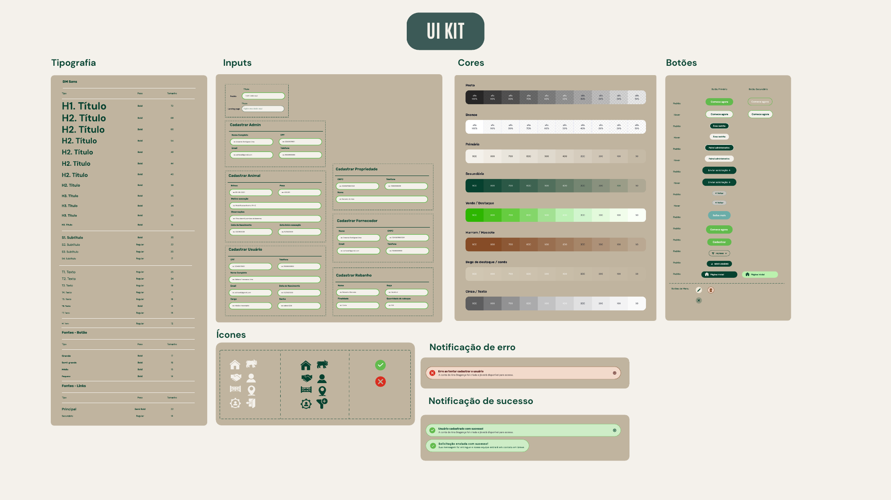

# UI Kit

Documentação do design system do ARGOS: tipografia, cores, ícones, botões, inputs e notificações de sucesso e de erro.

- **Figma:** [UI Kit](https://www.figma.com/design/QjdqHw78VlVQRPn39ML1gR/INTERDISCIPLINAR?node-id=3457-817)

